# Práctica 04: Modelo relacional. Viveros

- **Autores:** Adrián Pérez Poleo y Javier Bueno Calzadilla  
- **Fecha:** Semana del 12/10/2026 - 18/10/2026

## Diagrama Entidad - Relación
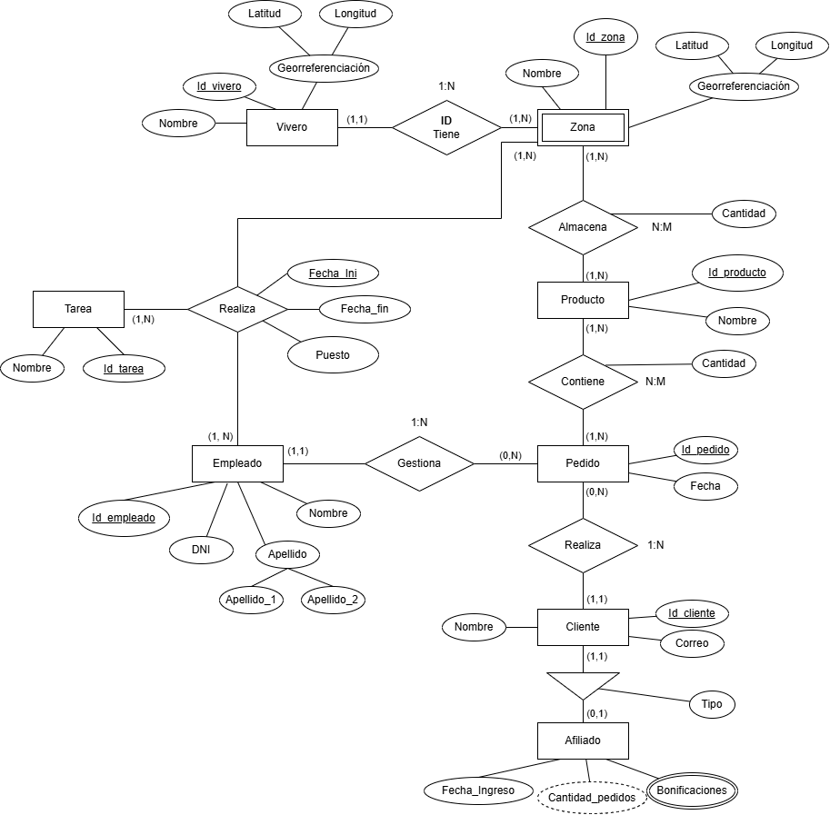

## Modelo Relacional
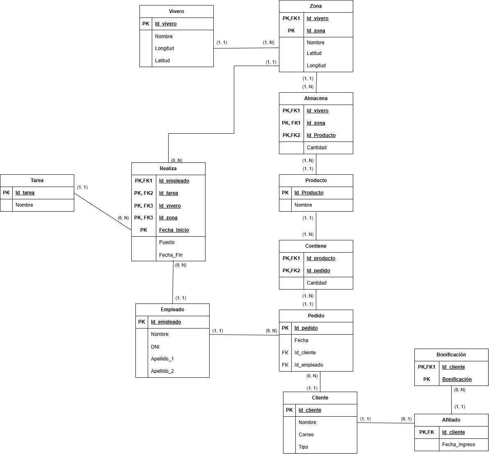

## Imágenes del contenido de las tablas

A continuación se muestra en las imágenes como han quedado las tablas tras la ejecución del script.

### Tabla 1. Vivero

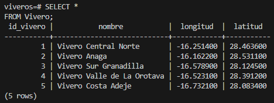

### Tabla 2. Zona

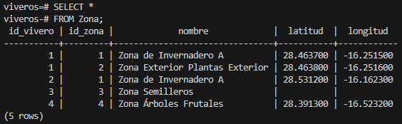

### Tabla 3. Producto

### Tabla 4. Almacena

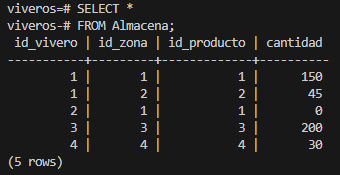

### Tabla 5. Empleado

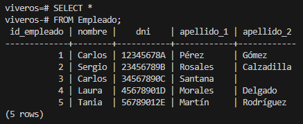

### Tabla 6. Cliente

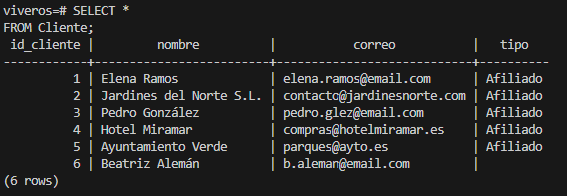

### Tabla 7. Afiliado

En este caso mostramos dos resultados de consulta, cuya diferencia es la inclusión del atributo derivado.

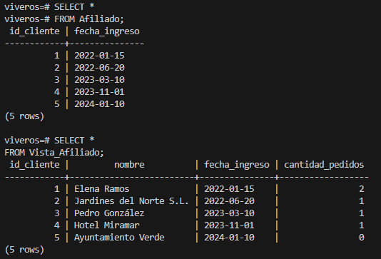

### Tabla 8. Bonificacion

En la segunda consulta podemos apreciar toda la información que disponemos de cada Afiliado.

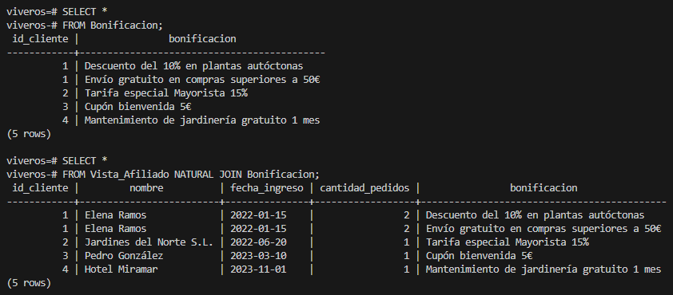

### Tabla 9. Pedido

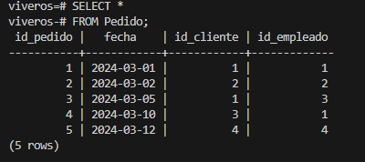

### Tabla 10. Contiene

La segunda consulta se ha realizado para mejorar la legibilidad.

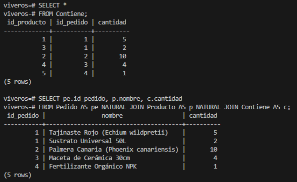

### Tabla 11. Tarea

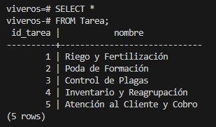

### Tabla 12. Realiza

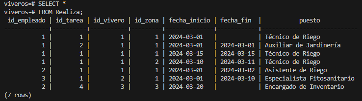
